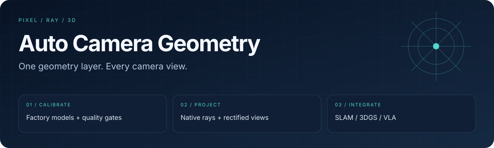
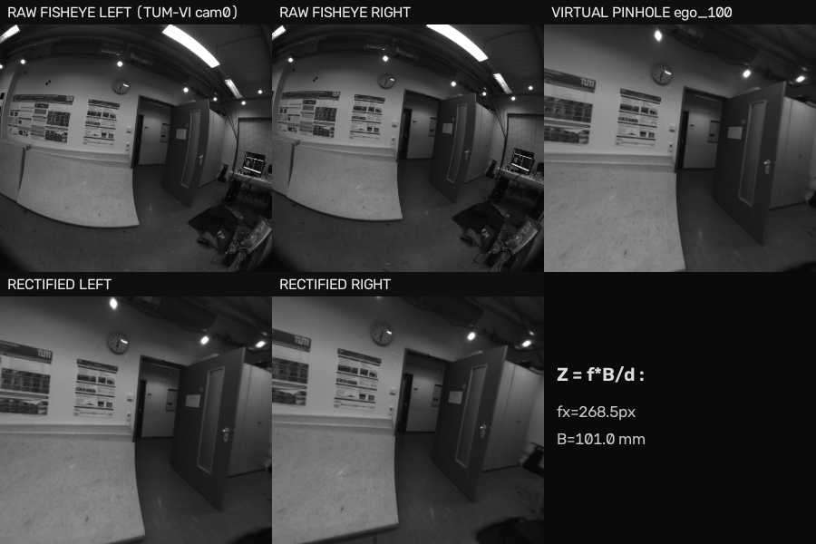

<div align="center">
  
  <h1>Auto Camera Geometry</h1>
  <p><strong>Calibrated pixels → native rays → useful 3D views.</strong></p>
  <p><a href="https://github.com/eust-w/camera-undistortion/actions/workflows/ci.yml"></a>
  
  
  </p>
  <p>
    <a href="#overview">Overview</a> ·
    <a href="#quick-start">Quick start</a> ·
    <a href="#workflow">Workflow</a> ·
    <a href="#validation">Validation</a> ·
    <a href="#documentation">Documentation</a>
  </p>
  <p><a href="README.md">English</a> · <a href="README.zh-CN.md">简体中文</a></p>
</div>

---

<a id="overview"></a>
## One camera model, multiple downstream views

**Auto Camera Geometry** turns factory calibration into a reusable geometry layer for fisheye and stereo cameras. Parse and check calibration once, then derive native rays, virtual pinhole views, rectified stereo and depth for downstream applications.

| Native geometry | Model-friendly images | Explicit quality gates |
| :--- | :--- | :--- |
| Pixel ↔ ray projection for SLAM, triangulation and 3D rendering | Virtual pinhole presets for VLM/VLA and 2D vision | Calibration checks, staged recovery and recorded quarantine reasons |

### A real-data reference



*Repository demo: TUM-VI fisheye images with Double Sphere calibration. This illustrates the camera pipeline; it is not a downstream SLAM or policy benchmark.*

<a id="quick-start"></a>
## Quick start

Requires **Python 3.11+**. Start with the bundled example calibration; it does not require downloading a dataset.

```bash
git clone https://github.com/eust-w/camera-undistortion.git
cd camera-undistortion
python3 -m venv .venv
source .venv/bin/activate
python -m pip install -e '.[dev]'

camera-geometry inspect-camera --config configs/device_orbbec_example.yaml
camera-geometry validate-calibration --config configs/device_orbbec_example.yaml
```

The example contains placeholder right-camera intrinsics. It demonstrates the schema and CLI, not a verified calibration for your device.

For a stereo episode, provide its own calibration and an input directory matching the [pipeline](src/camera_geometry/pipeline.py) layout:

```bash
camera-geometry process-dataset \
  --input /path/to/episode --output /path/to/output \
  --config /path/to/device.yaml
```

### Python API

```python
import numpy as np
from camera_geometry.calibration.parser import load_device_calibration
from camera_geometry.models.factory import build_camera

calibration = load_device_calibration("configs/device_orbbec_example.yaml")
camera = build_camera(calibration.camera("IR_L"))
pixels = np.array([[800.0, 650.0]])
rays = camera.pixel_to_ray(pixels)
reprojected = camera.ray_to_pixel(rays)
```

<a id="workflow"></a>
## From calibration to deliverables

```text
Factory calibration
       │
       ▼
Schema · rotation · baseline · projection checks
       │
       ├── accepted ──► cached geometry ──► rays / views / stereo / depth
       │
       └── recovery ──► stereo refinement → optional COLMAP / dense-ray fitting
                              │
                              └── unresolved ──► quarantine + reason
```

| Camera model | Implementation |
| :--- | :--- |
| Kannala–Brandt 4 | [KB4 model](src/camera_geometry/models/kb4.py) |
| Double Sphere | [DS model](src/camera_geometry/models/double_sphere.py), including negative `xi` |
| Extended Unified Camera Model | [EUCM model](src/camera_geometry/models/eucm.py) |
| Brown–Conrady | [Brown model](src/camera_geometry/models/brown.py) |
| Pinhole | [Virtual/rectified camera model](src/camera_geometry/models/pinhole.py) |

### Connect a downstream application

```bash
python examples/slam_adapter.py
python examples/render_for_3dgs.py
python examples/handpose_3d.py
```

These examples demonstrate geometry contracts. They do not bundle a SLAM backend, Gaussian renderer or hand-pose model.

<details>
<summary><strong>Run the optional HTTP service</strong></summary>

```bash
python -m pip install -e '.[server]'
uvicorn camera_geometry.service:app --host 127.0.0.1 --port 8300
```

The [service](src/camera_geometry/service.py) exposes calibration resolution, ray maps, virtual cameras, stereo rectification, jobs, `/healthz` and `/metrics`.

</details>

<details>
<summary><strong>Reproduce the TUM-VI input preparation</strong></summary>

```bash
python scripts/fetch_tumvi_subset.py \
  --url https://cdn2.vision.in.tum.de/tumvi/exported/euroc/512_16/dataset-room1_512_16.tar \
  --out third_party/tumvi/room1 --per-cam 40
python scripts/import_tumvi.py --root third_party/tumvi/room1 \
  --calib /path/to/tumvi_512_ds_calib.json --out outputs/tumvi_episode
camera-geometry process-dataset --input outputs/tumvi_episode \
  --output outputs/tumvi_processed --config outputs/tumvi_episode/device.yaml
```

Supply the matching TUM-VI Double Sphere calibration JSON separately. The image-fetch command is not a calibration downloader. See the [import script](scripts/import_tumvi.py).

</details>

<a id="validation"></a>
## Validation and operating boundaries

```bash
python -m pytest
python -m mypy src/camera_geometry
python scripts/benchmark.py --help
```

CI configuration and tests are linked directly rather than represented by a fixed “passed” count.

| Area | Current boundary |
| :--- | :--- |
| Input calibration | A video alone is not sufficient. Use calibration belonging to that camera. |
| Virtual views | Built-in presets target 90° / 100° / 110°; wider rectilinear views amplify edge stretching. |
| Stereo refinement | Horizontal-baseline parity does not identify every parameter; `fx/cx` stay anchored and the reference camera is held fixed. |
| Dense-ray fallback | Requires a compatible provider; pretrained AnyCalib weights are not bundled. |
| Rolling shutter | Row-aware interfaces need external readout-time and motion metadata. |
| Video helper | `scripts/undistort_video.py` embeds a particular factory profile; do not apply it unchanged to an unrelated camera. |

<a id="documentation"></a>
## Explore the repository

| Start here | What you will find |
| :--- | :--- |
| [Example calibration](configs/device_orbbec_example.yaml) | Device, camera, intrinsics and extrinsics layout |
| [Pipeline](src/camera_geometry/pipeline.py) | Episode processing and output orchestration |
| [Calibration recovery](src/camera_geometry/fallback/) | Optional recovery stages and integration hooks |
| [Tests](tests/) | Geometry, calibration, pipeline and regression coverage |
| [CI](.github/workflows/ci.yml) | Automated repository checks |

## License

Code is licensed under [Apache-2.0](LICENSE). External datasets, calibration files and model assets retain their own terms.
